<p align="center">
  
</p>

<p align="center">
  <a href="LICENSE"></a>
  &nbsp;
  <a href="https://claude.com/claude-code"></a>
  &nbsp;
  
</p>

<p align="center">
  An agentic job search CLI with Claude Code skills.<br>
  One evidence-backed profile, a tailored ATS-ready resume for every role,<br>
  and nothing is sent without your approval.
</p>

> [!NOTE]
> Offerstar is an independent open-source project, not affiliated with or endorsed by Anthropic. Claude Code is named only to describe the toolchain it uses.

## How it works

<p align="center">
  
</p>

> Early development: the evidence profile, resume building, job discovery, the apply flow and tracking work. The Naukri add-on, installers and the learning loop come next.

## Use it with Claude Code

```sh
npm install && npm link          # puts the offerstar command on your PATH (Node 22.18+)
```

Then, in Claude Code:

```
/plugin install offerstar --marketplace himanshu-mamgain/offerstar
/offerstar:setup                 # role, contact details and your evidence profile
/offerstar:plan                  # scan your companies and rank the jobs
/offerstar:apply <jobId>         # a tailored, evidence-grounded draft for your approval
```

Claude drafts; the CLI refuses any bullet, number, skill or screening answer the evidence blocks don't support; you approve each application yourself in your own terminal with `offerstar apply approve <jobId>`, then submit it.

## Development

Needs Node 22.18 or newer, which runs the TypeScript sources directly.

```sh
npm install
npm run offerstar -- init --role "Backend engineer" --name "Your Name" --email you@example.com --phone "+91 ..."
npm run offerstar -- import github <user>   # one project block per public repo you own
npm run offerstar -- import npm <user>      # one project block per npm package you maintain
npm run offerstar -- resume build           # renders a PDF from your evidence blocks
npm run offerstar -- check <pdf>            # round-trip parse test, as an ATS would read it
npm run offerstar -- companies add <name or careers URL>   # finds its Greenhouse, Lever or Ashby board
npm run offerstar -- scan                   # fetches, cleans and dedupes jobs from every tracked company
npm run offerstar -- paste --title "..." --company "..." < posting.txt   # a posting copied from anywhere
npm run offerstar -- plan                   # scores open jobs against your profile; prints the shortlist
npm run offerstar -- jobs show <id>         # one cleaned posting with its skills and guard flags
npm run offerstar -- apply render <draft.json>   # audit a draft against the evidence, render and check it
npm run offerstar -- apply approve <id>     # you review and approve; only works at a terminal
npm run offerstar -- status                 # applications by stage, follow-ups due
npm run offerstar -- outcome <id> interview --round "technical 1" --question "..." --rating 4
npm run offerstar -- rate <id> good|bad
npm run offerstar -- insights               # call rates by channel, role match, resume variant, with ranges
npm run offerstar -- doctor                 # checks the install and the Offerstar folder
npm run typecheck
npm test
```

Evidence blocks are YAML files in `~/.offerstar/profile/`; importers never overwrite a block you have edited. The first resume build downloads Typst into `~/.offerstar/bin` and verifies its checksum, unless `typst` is already on your PATH.

Set `OFFERSTAR_HOME` to use a folder other than `~/.offerstar`, for example while testing.

All personal data stays in that folder on your machine. The repo holds only the tool and tests that use a fictional profile.
